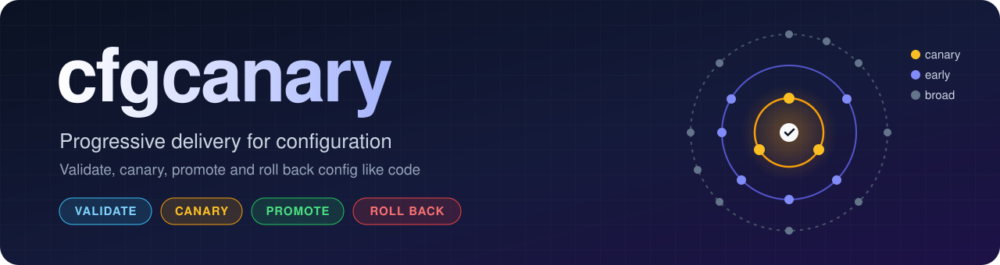
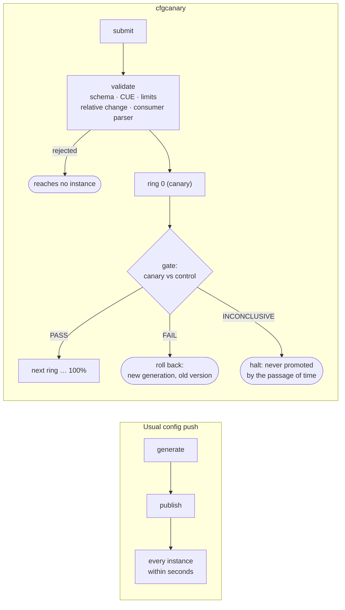
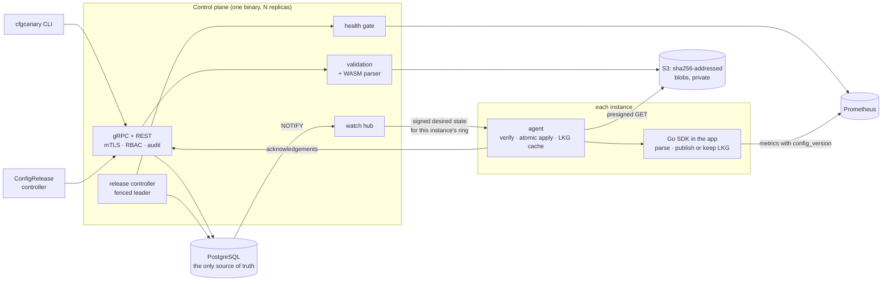

<p align="center">
  
</p>

<p align="center">
  <a href="https://github.com/raunaksahahere/cfgcanary/actions/workflows/ci.yml"></a>
  
  <a href="LICENSE"></a>
  
  
</p>

<p align="center">
  <a href="#quickstart"><b>Quickstart</b></a> ·
  <a href="#what-it-stops"><b>What it stops</b></a> ·
  <a href="#how-it-works"><b>How it works</b></a> ·
  <a href="#measured-results"><b>Results</b></a> ·
  <a href="#guarantees-and-non-guarantees"><b>Guarantees</b></a> ·
  <a href="#documentation"><b>Documentation</b></a>
</p>

---

**Progressive delivery for configuration: validate, canary, promote and roll back config like code.**

Code goes through canaries. Runtime configuration often does not: a feature file, a rate-limit
table or a policy document is generated, published, and in seconds every machine reads it. If the
content is wrong, the whole fleet finds out at once. Cloudflare's
[18 November 2025 post-mortem](https://blog.cloudflare.com/18-november-2025-outage/) describes a
generated feature file that doubled in size, exceeded a hard-coded limit in the proxy and was pushed
to every machine; Google Cloud's [12 June 2025 incident report](https://status.cloud.google.com/incidents/ow5i3PPK96RduMcb1SsW)
describes policy data with blank fields replicated globally to a code path without error handling.

**cfgcanary** treats configuration as a release. Every version is validated (including by the
consumer's own parser, sandboxed), signed, and delivered ring by ring. A Prometheus health gate
compares each ring with the instances that did not get the change and promotes, halts or rolls back.
Agents apply updates atomically and the Go SDK keeps applications on their last-known-good config
when anything goes wrong.



```console
$ docker compose -f deploy/compose/compose.yaml run --rm cli demo
== invalid submissions are stopped before any agent can see them
  bad-oversized.json         rejected  [limits/too_large] payload is 74212 bytes; the limit is 65536
  bad-over-cardinality.json  rejected  [limits/too_many_items] 201 items; the limit is 200
  bad-doubled.json           rejected  [relative/size_grew] size grew from 5195 to 12591 bytes (x2.42); the limit is x2.00
  bad-blank-service.json     rejected  [schema/minLength] minLength: got 0, want 1
  bad-parser-rule.json       rejected  [wasm/rejected] features[0].rule: expected `key == value` or `key != value` terms join...
  bad-malformed.json         rejected  [json/syntax] malformed JSON: unexpected end of JSON input

== a schema-valid but harmful change (timeout_ms 250 -> 20) is caught in the canary ring
submitted v3-harmful-timeout.json -> v3 (validation passed: [limits schema cue relative wasm])
13:06:39  PENDING ring=-1
13:06:40  BAKING ring=0 accepted=8/8 gate=-
13:07:01  ROLLED_BACK ring=0 accepted=0/8 gate=FAIL(look 1) rollback: confirmed=8/8 pending=0 unreachable=0 reason=gate_fail
RING      CUMULATIVE  PHASE        ELIGIBLE  REACHABLE  APPLIED  ACCEPTED  REJECTED  FAILED  GATE
0 canary  15.00%      rolled_back  8         8          0        0         0         0       FAIL (look 1)
1 early   40.00%      pending      16        16         0        0         0         0       -
2 broad   90.00%      pending      22        22         0        0         0         0       -
holdout   -           control      4         4          -        -         -         -       -
gate ring 0: errors: canary proportion 0.9155 is at or above the hard limit 0.5000
rollback: fallback v2 at generation 8: 8/8 exposed instances confirmed, 0 pending, 0 unreachable (converged)

== result
blast radius: 8 of 50 instances (ring 0) were exposed to v3; rings 1-2 and the holdout: 0
time to detect (release created -> rollback started): 20.6s
time to roll back (rollback started -> all reachable exposed instances confirmed v2): 200ms
```

<sub>A real run of the Compose demo on a laptop (Ryzen 5 5600H): 50 simulated instances running the real agent and SDK, 40 synthetic requests per second each. Detection time is the policy's 20 s minimum bake plus the first gate look.</sub>

## Three gate verdicts, and nothing in between

| Verdict | What happens | Meaning |
|---|---|---|
| ✅ **PASS** | promote to the next ring | Every evidence metric showed the canary within its tolerated degradation (non-inferiority test). |
| ❌ **FAIL** | roll back (or halt, by policy) | A metric showed degradation beyond its tolerance, or crossed a hard limit. SDK rejections and crash loops roll back without waiting for the gate. |
| ⚠️ **INCONCLUSIVE** | keep baking; **halt** after the last declared look | Missing, stale, insufficient, NaN or inconsistent evidence, or a degraded control cohort. Unknown evidence never promotes. |

## What it stops

| What goes wrong | Where cfgcanary stops it | Instances that see it |
|---|---|---|
| Oversized or over-cardinality file (the Cloudflare shape) | byte and item limits before parsing | 0 |
| File that suddenly doubles or shrinks | relative-change guard against the deployed baseline | 0 |
| Malformed JSON, duplicate keys, blank required fields | strict parser, JSON Schema, CUE | 0 |
| Accepted by the schema but not by the consumer (the CrowdStrike Channel File 291 shape) | the consumer's own parser compiled to WASM, run in a wazero sandbox | 0 |
| Passes every validator, breaks the service at runtime | canary ring + health gate, automatic rollback | the canary ring only (8/50 in the demo) |
| Rejected by an application whose parser is stricter than the server's checks | SDK keeps last-known-good, reports `REJECTED`, release rolls back | 0 applications serve it |
| Control plane, database, object store or Prometheus outage | static stability: agents keep their verified cache; gates halt without evidence | nothing changes |

## Quickstart

Needs only Docker (with Compose v2). Nothing else is installed on your machine.

```bash
git clone https://github.com/raunaksahahere/cfgcanary && cd cfgcanary
scripts/demo.sh          # build, start, run the scenario, outage and kill-switch scenes
scripts/demo.sh down     # stop and delete the stack's volumes
```

On the test laptop the whole walkthrough took **189 s** once images existed (12 s from `up` to every
service healthy, 94 s for the scenario). The first run also pulls base images and builds the
cfgcanary image (about 6 minutes there, depending on your connection).

The stack: PostgreSQL, an S3-compatible store, Prometheus, Grafana, the control plane, a Toxiproxy
fault proxy and 50 simulated instances (real agents and SDK clients). Everything is authenticated:
mTLS for agents and operators, ed25519-signed artifacts, credentials generated into a Docker volume.
Grafana is at <http://localhost:3000> and Prometheus at <http://localhost:9090> (bound to localhost).

Step by step, or with your own commands:

```bash
docker compose -f deploy/compose/compose.yaml up -d --build --wait
alias cfgcanary='docker compose -f deploy/compose/compose.yaml run --rm cli'
cfgcanary demo                                    # the scripted scenario
cfgcanary releases list
cfgcanary releases status <release-id> --watch
cfgcanary --as viewer kill-switch ratelimits --reason test   # denied: exit code 5
```

<details>
<summary><b>What <code>scripts/demo.sh</code> also shows: outage survival and a kill switch under partition</b></summary>

```console
== control-plane outage: stop the server; applications keep serving their last-known-good config
instances serving each version while the control plane is down (from the SDKs' own metrics):
  config_version:2, = 50
after restart, watch streams re-established: 50

== kill switch while every agent is partitioned from the control plane
link between agents and control plane: cut (Toxiproxy)
kill switch engaged for ratelimits/prod: baseline v1, generation 9, target frozen (demo: emergency revert during a partition)
while partitioned:
rollback: fallback v1 at generation 9: 0/50 exposed instances confirmed, 0 pending, 50 unreachable (NOT converged: unreachable instances will reconcile when they reconnect)
link restored; agents reconnect with jittered backoff and reconcile
rollback: fallback v1 at generation 9: 50/50 exposed instances confirmed, 0 pending, 0 unreachable (converged)
```

A rollback is reported as converged only when every exposed instance has confirmed the fallback.
Disconnected instances are listed, never assumed.

</details>

## How it works



1. **Submit.** The server runs the config's validation pipeline (limits, strict JSON, JSON Schema,
   CUE, relative change against each environment's deployed baseline, then the consumer parser in
   wazero with memory, time and output limits and no filesystem, environment or network). A rejected
   version is never stored.
2. **Release.** A dry-run plan shows real cohort sizes per ring; a percentage does not guarantee a
   non-empty canary in a small fleet, so the plan refuses one that is too small. Ring membership is a
   stable hash of the *authenticated* instance identity, frozen with the release.
3. **Deliver.** Each desired-state change is a new generation. Agents receive a signed delivery
   statement for their ring, download the content-addressed blob, verify signature, scope and digest,
   and swap their cache pointer with write-temp, fsync, rename, fsync(dir).
4. **Accept.** The SDK re-verifies, parses with the application's parser, and publishes an immutable
   snapshot, or keeps the previous one and reports `REJECTED`.
5. **Gate.** The controller compares canary and control cohorts per metric (errors, latency as a
   fraction over a histogram bucket, restarts), with a harm test and a non-inferiority test,
   instance-clustered variance and error split across the declared looks.
6. **Promote or roll back.** A rollback is a newer generation pointing at the older version, so no
   delayed message can reapply the bad one.

The release state machine is pure code (`internal/rollout`), PostgreSQL holds every transition with
its audit event in one transaction, and the leader's writes carry a fencing epoch that the database
checks in the same transaction. Details: [ARCHITECTURE.md](docs/ARCHITECTURE.md) and
[invariants.md](docs/invariants.md).

### Kubernetes

```yaml
apiVersion: cfgcanary.io/v1alpha1
kind: ConfigRelease
metadata: {name: ratelimits, namespace: demo}
spec:
  config: ratelimits
  payloadFrom: {configMapKeyRef: {name: ratelimits-v2, key: payload.json}}
```

The `ConfigRelease` controller is a client of the control plane, not a second source of truth: it
submits the payload, creates the release (idempotently, keyed by the resource's UID and generation),
mirrors its status, and writes each ring's signed payload into a `<config>-<env>-ring-<n>` ConfigMap.
Pods consume their ring's ConfigMap through the agent sidecar and the SDK and report back with a
group certificate pinned to a ring. A bare ConfigMap mount without the agent gets no verification,
last-known-good or acknowledgement, and kubelet's sync delay still applies.
[`scripts/kind-demo.sh`](scripts/kind-demo.sh) installs the [Helm chart](deploy/helm/cfgcanary) on
kind and checks every step: ring-by-ring delivery to six pods, rejection, upgrade to two replicas,
uninstall (passed in 640 s on the test laptop).

## Measured results

From `scripts/bench.sh` on a Ryzen 5 5600H laptop (12 threads, 7 GB RAM) against the services in
[`deploy/compose/test-deps.yaml`](deploy/compose/test-deps.yaml). Raw JSON/CSV, definitions, commit
and commands: [`bench/results/`](bench/results) (summary: [`summary.md`](bench/results/summary.md)).

**Blast radius of a schema-valid, runtime-harmful change** (50 instances, `timeout_ms` 250 → 20;
statistical gate only, no hard limit; 3 repetitions):

| System | Targeted | Agent applied | SDK accepted | Time to detect | Time to roll back |
|---|---:|---:|---:|---:|---:|
| cfgcanary, rings 15 / 40 / 90 % + holdout | 8/50 (all 3 runs) | 8/50 | 8/50 | 10.2–10.3 s | 0.08–0.09 s |
| naive push-to-all (isolated benchmark mode of the same system) | 50/50 | 50/50 | 50/50 | not detected | none |
| rolling restart on ConfigMap change (Reloader-style **model**, not the real product) | 50/50 | 50/50 | 50/50 | not detected | none |

Detection is bounded below by the minimum bake (10 s here). Rollback time is measured until every
exposed instance confirmed the fallback.

**Reconnect storm** (1,000 agents, control plane killed with SIGKILL, down 5 s, restarted; admission
limit raised so the curve shows client behaviour):

| Backoff | Peak attempts / 100 ms | Peak in any 100 ms after restart | Total attempts | Restart → all reconnected |
|---|---:|---:|---:|---:|
| full jitter | 520 | 36 | 5,936 | 9.8 s |
| no jitter (lockstep baseline) | 990 | 728 | 5,000 | 3.3 s |

Full jitter halved the worst burst and spread reconnections after the restart (36 instead of 728 in
the busiest 100 ms), at the cost of slower full reconnection and more total attempts. The server's
admission control (token bucket plus stream cap) bounds the rest.

**Gate behaviour by canary size** (simulation of the production gate code, 4 looks, margin 2 points
on a 1 % baseline, 200 requests per instance per look, identical instances):

| Canary instances | No change | +0.5 pt (inside margin) | +2 pt (at margin) | +5 pt (harmful) |
|---:|---|---|---|---|
| 5 | promote 100 % | promote 99 % | promote 0.1 %, halt 99.9 % | roll back 92 %, halt 8 % |
| 50 | promote 100 % | promote 100 % | promote 2.5 %, halt 97 % | roll back 100 % |
| 500 | promote 100 % | promote 100 % | promote 4 %, halt 96 % | roll back 100 % |

With heterogeneous instances or low traffic, 5 canaries mostly **halt**: they cannot produce evidence
either way, so they never promote harm but need an operator or a `hard_max`. Full table, including
heterogeneous and low-traffic cases: [`summary.md`](bench/results/summary.md).

**Propagation at scale** (all agents, the control plane and PostgreSQL on one laptop; per ring,
from the ring's exposure committed in PostgreSQL; p50 / p99):

| Agents | Update received by agent | Applied (durable) | Served by the SDK | Rollback confirmed by every exposed agent |
|---:|---|---|---|---|
| 100 | 11–21 ms / 13–28 ms | 37–55 ms / 40–63 ms | 39–56 ms / 43–63 ms | 0.11 s (54 agents) |
| 1,000 | 0.33–0.44 s / 0.56–0.71 s | 1.2–1.5 s / 1.5–1.8 s | 1.3–1.5 s / 1.5–1.8 s | 2.07 s (489 agents) |
| 5,000 | 2.0–3.1 s / 4.1–8.8 s | 9.9–17.7 s / 12.5–26.1 s | 9.7–18.3 s / 12.5–25.5 s | 13.4 s (2,497 agents) |

Ranges span the three rings. "Received" is the control plane's fan-out. "Applied" and "served"
add each agent's fsyncs; in the simulator every agent shares one disk with the server and
PostgreSQL, so at 5,000 they measure that contention more than delivery, and separate hosts would
not share it. The 5,000-agent run needed a raised task limit (the session's cgroup allowed 7,177
tasks; see [benchmarks.md](docs/benchmarks.md#limits-and-caveats)). Marginal control-plane cost: **about 115 MB of memory and
0.03 CPU cores (idle) per 1,000 open watch streams**.

**Chaos suite** (12 scenarios: leader killed mid-rollout, lock session lost, partition during a
rollback, stalled consumer, reconnect storms, Prometheus down, no metrics, object-store and database
outages, crash loop, cold restart without the control plane): all pass, **0 agent or SDK crashes**.
State-machine statement coverage: 93.6%.

## Guarantees and non-guarantees

> [!IMPORTANT]
> v0.1.0 is an alpha. These are the properties the code is built and tested to hold; they are not
> a production-readiness claim.

**Guaranteed by design and tested** ([invariants.md](docs/invariants.md)):
- A version rejected by validation reaches no instance. Versions and blobs are immutable.
- An instance only ever holds content its ring was authorized for: the ring comes from its
  certificate, not its request, and the signed delivery statement names the ring range.
- Generations only increase. A rollback is a new generation; stale messages and acknowledgements
  cannot overwrite newer state.
- One controller acts at a time; a deposed leader's writes are rejected by the fencing epoch.
- Missing, stale or insufficient metrics never promote. A paused or halted release never advances
  on its own.
- Agents acknowledge `APPLIED` only after verification and a durable write; the SDK reports
  `ACCEPTED` only after the application's parser accepted and published it.

**Not guaranteed:**
- Disconnected instances are not rolled back until they reconnect; the CLI lists them.
- A canary that does not exercise the faulty code path will not reveal the fault.
- The gate bounds error rates under stated assumptions (independent requests within an instance
  given its rate, no time trends); it is not a proof of safety.
- Last-known-good keeps a service running; it does not make an old value correct forever. Configs
  declare `fail_static` or `fail_closed` for what staleness should mean.
- Compromise of the signing keys, PostgreSQL or the CA is out of scope. Config payloads are not a
  secrets channel.

## Documentation

| | |
|---|---|
| 🚀 [Usage](docs/usage.md) | CLI commands, exit codes and JSON output, the config spec, the Go SDK, the agent |
| 🧱 [Architecture](docs/ARCHITECTURE.md) | Components, data model, state machine, delivery path, trust, Kubernetes mode |
| 🛡️ [Failure model and invariants](docs/invariants.md) | What is promised, how it is enforced, which tests try to break it, fail-open vs fail-closed |
| 🎓 [Design guide](docs/design-guide.md) | The code paths and the reasoning: generations, fencing, static stability, jitter, gate statistics |
| 🔌 [Protocol and API](docs/protocol.md) | Watch semantics, signed statements, acknowledgements, REST mapping ([OpenAPI](api/openapi/cfgcanary/v1/cfgcanary.swagger.json)) |
| ⎈ [Kubernetes](docs/kubernetes.md) | `ConfigRelease`, ring ConfigMaps, the Helm chart, what a ConfigMap alone cannot promise |
| 🧯 [Runbooks](docs/runbooks.md) | Emergencies, halted releases, outages, shutdown and upgrades, backups, rotation, retention |
| 📈 [Observability](docs/observability.md) | Metrics and cardinality, tracing, logs, audit |
| 📊 [Benchmarks](docs/benchmarks.md) | Method, reproduction and limits; results in [`bench/results`](bench/results/summary.md) |
| ✅ [Requirements and evidence](docs/requirements.md) | Every requirement mapped to code, verification and status |
| 🧭 [Decisions](docs/decisions) · [Compatibility](docs/compatibility.md) · [Changelog](CHANGELOG.md) | ADRs, versioning promise, release history |

<details>
<summary><b>Development</b></summary>

```bash
make help                 # every target
make build                # bin/cfgcanary
make test                 # unit, property and fuzz-seed tests with -race
make test-integration     # starts PostgreSQL, S3, Prometheus, Toxiproxy; integration tests
make chaos                # fault-injection suite
scripts/bench.sh          # measurements -> bench/results
scripts/kind-demo.sh      # Kubernetes example on kind
```

Layout: `cmd/cfgcanary` (one binary), `api/` (protobuf, generated code, OpenAPI), `internal/`
(rollout state machine, store, validation, gate, auth, server, controller, agent, cache, kube, sim),
`sdk/` (public Go SDK), `migrations/`, `examples/ratelimits` (spec, payloads, consumer parser and its
WASM validator), `deploy/` (Compose, Helm, kind), `test/` (integration and chaos), `bench/`.

</details>

## Prior art

[Argo Rollouts](https://argoproj.github.io/rollouts/) and [Flagger](https://flagger.app/) do
progressive delivery of deployments with analysis; [Stakater Reloader](https://github.com/stakater/Reloader)
restarts workloads when ConfigMaps change; feature-flag systems such as
[OpenFeature](https://openfeature.dev/)/flagd, Unleash and Flipt roll out flags. Meta's
[Configerator](https://research.facebook.com/publications/holistic-configuration-management-at-facebook/)
and Google's [canarying practices](https://sre.google/workbook/canarying-releases/) describe this
problem at scale. cfgcanary packages content validation, ring propagation, health gating and
last-known-good consumers for arbitrary structured config in one small open-source system.

## Contributing and security

Issues and pull requests are welcome: see [CONTRIBUTING.md](CONTRIBUTING.md). Report
vulnerabilities privately as described in [SECURITY.md](SECURITY.md).

## License

[Apache-2.0](LICENSE)
