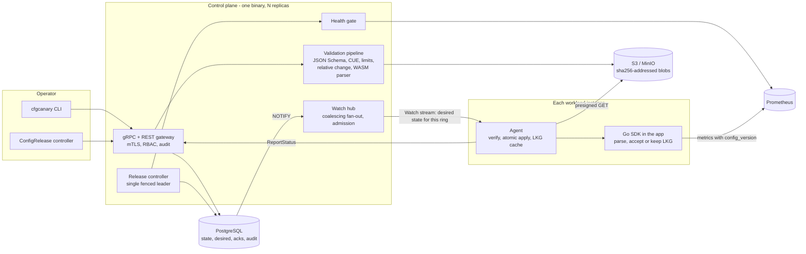
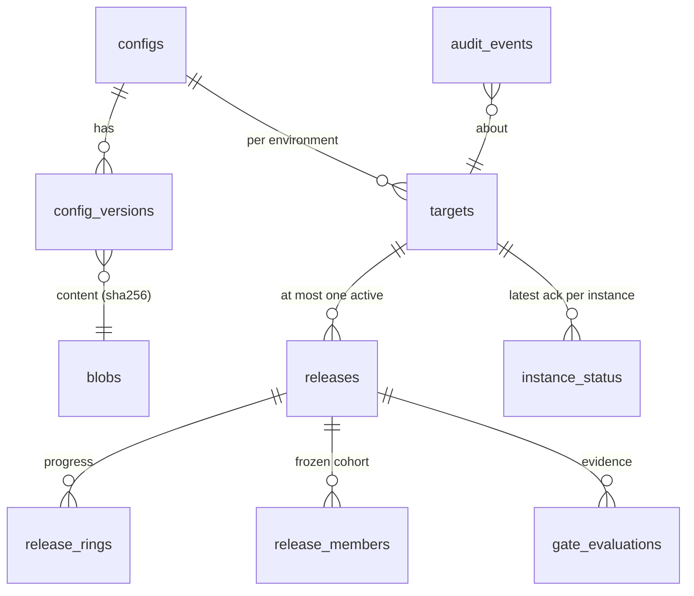
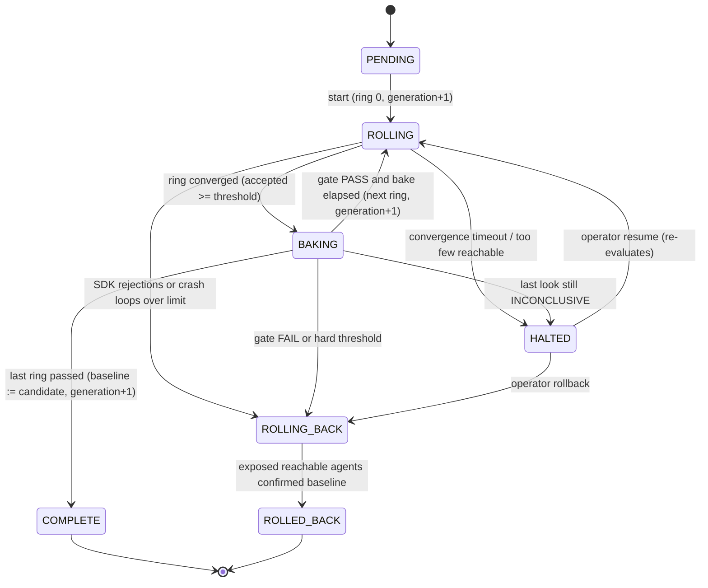

# Architecture

cfgcanary delivers structured runtime configuration the way a careful team delivers code:
validate it, expose it to a small cohort, compare that cohort with one that did not get it, and
only then widen exposure. Consumers keep running on the last config they accepted.

Read [invariants.md](invariants.md) first; this page explains the parts that enforce it.

## Components

| Package | Responsibility | I/O |
|---|---|---|
| `internal/rollout` | Pure release state machine: `Decide(snapshot, now) -> action`. No clocks, no database. | none |
| `internal/ring` | Stable hash-to-bucket assignment, policy validation, cohort sizing. | none |
| `internal/gate` | Statistics (`stats.go`, pure) and the Prometheus evidence collector. | Prometheus HTTP API |
| `internal/validate` | Limits, JSON Schema, CUE, relative-change guard, wazero sandbox. | none (sandboxed) |
| `internal/sign` | ed25519 statements, key IDs, trust bundle. Standard library only. | none |
| `internal/store` | PostgreSQL: migrations, transactions, fencing check, audit. | PostgreSQL |
| `internal/blob` | Content-addressed object store, presigning, garbage collection. | S3 |
| `internal/auth` | mTLS identity parsing, RBAC policy, gRPC interceptors. | none |
| `internal/server` | gRPC services, REST gateway, watch hub, admission, ack batching. | network |
| `internal/controller` | Leader election, reconcile loop that applies `rollout` decisions. | PostgreSQL |
| `internal/agent` | Watch client, download, verify, durable cache, status reporting. | network, disk |
| `sdk` | Public consumer library: `Open`, `Get`, LKG, crash-loop guard, metrics. | disk |
| `internal/kube` | ConfigRelease reconciler and per-ring ConfigMap projection. | Kubernetes API, cfgcanary API |
| `internal/sim` | Simulated fleet of real agents and sample apps in one process. | network, disk |

One binary, `cfgcanary`, exposes these as subcommands (`server`, `agent`, `k8s-controller`,
`sim`, and the operator commands).

## Data model

- `targets(config, environment, generation, baseline_version, candidate_version, active_ring,
  release_id, previous_good_version, frozen)` is the desired state. An instance's desired
  version is `candidate` if a release is active and `ring(instance) <= active_ring`, otherwise
  `baseline`.
- `releases` holds the state, the frozen policy snapshot (rings, salt, thresholds, gate
  settings), `state_version` for optimistic rechecks and the controller `epoch` that last wrote
  it.
- `instance_status` is last-writer-wins by generation, never by arrival time.
- `audit_events` is append-only (enforced by a trigger that rejects `UPDATE` and `DELETE`).

## Release state machine

`paused` is a flag on any active state, not a state: the controller takes no forward action
while it is set, and bake looks do not accrue. `rollback` and `kill-switch` are accepted in any
active state.

The transition function lives in `internal/rollout` and is exercised by table tests and by
randomized interleavings of promote, pause, resume, rollback, kill switch, leader change, agent
acknowledgements and reconnects against a reference model.

## Delivery path

1. **Submit.** The API stream-limits the request, runs the validation pipeline against the
   config's policy and the correct base version, writes the bytes to `sha256/<hex>` in the
   object store, then inserts the version row and signs the artifact statement in one
   transaction. Blob first, reference second: a crash in between leaves an unreferenced blob for
   the collector, never a dangling reference.
2. **Release.** `plan` computes cohort sizes from current members and the policy without
   writing anything. `create` freezes the policy and members and inserts a `PENDING` release.
3. **Advance.** The leader moves `active_ring`, bumps the generation and emits `NOTIFY` in the
   same transaction.
4. **Fan-out.** Every replica listens. The hub marks the target dirty for each subscribed
   stream; each stream's sender reads the latest snapshot and sends one `ConfigUpdate` with a
   signed delivery statement and a short-lived presigned URL. A periodic sweep covers a missed
   notification. There is no event log to fall behind on: a reconnecting agent states what it
   has and receives the current truth.
5. **Apply.** The agent verifies (trust, signatures, scope, ring range, size, digest), stores
   the object, swaps the pointer, and reports `APPLIED`.
6. **Accept.** The SDK parses with the application's parser, publishes or keeps LKG, and the
   agent reports `ACCEPTED` or `REJECTED`.
7. **Gate.** During the bake the controller evaluates evidence at the declared looks.

## Trust

- **Identity.** Agents and operators present client certificates. The URI SAN is the identity:
  `spiffe://<trust-domain>/env/<env>/agent/<instance>`, `.../env/<env>/group/<group>`,
  `spiffe://<trust-domain>/user/<name>`, `spiffe://<trust-domain>/service/<name>`. Full SPIRE is
  not required; any CA that issues these SANs works.
- **Authorization.** A server-side RBAC file maps identities to roles. Agent identities get the
  agent role implicitly and nothing else.
- **Artifacts.** Two ed25519 statements, each with a key ID (`hex(sha256(pubkey))[:16]`):
  the *artifact statement* binds bytes to `(config, version, sha256, size, environments)`; the
  *delivery statement* binds `(config, environment, generation, version, sha256, release,
  ring range, failure mode)`. Agents trust keys listed in a local trust bundle, by purpose.
- **Blobs.** The bucket is private. Agents receive presigned GET URLs only for versions their
  ring is entitled to, check the URL against a configured origin allow-list, do not follow
  redirects, and stop reading at the signed size.

## Kubernetes mode

The `ConfigRelease` controller is an API client of the control plane, not a second state
machine. It submits the payload, creates the release with an idempotency key derived from the
resource UID and generation, mirrors release status into `.status`, and projects each ring's
desired payload and signed envelope into a ConfigMap `<name>-ring-<i>`. PostgreSQL remains the
only source of release truth; deleting a ConfigMap just causes it to be rewritten.

Workloads consume a ring ConfigMap through the agent in `--source file` mode (verify, atomic
apply to a shared volume, report status) and the SDK. See [kubernetes.md](kubernetes.md) for
what a bare ConfigMap mount can and cannot promise.

## Decisions

Recorded in [decisions/](decisions/).
